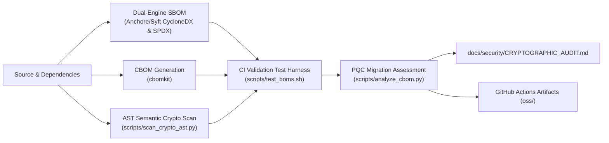

➜  SSO-Demo git:(main) ✗ python3 run_demo_v2_fixed.py 


=== STAGE 0: Init & Port Scanning ===
[INFO] EJBCA HTTPS: localhost:443
[INFO] EJBCA HTTP:  localhost:80
[INFO] Keycloak:    localhost:8080
Cleaning up old containers...
[CMD] docker-compose down -v --remove-orphans
[+] down 8/8
 ✔ Container ejbca               Removed                                                                                                                                                                   1.3s
 ✔ Container keycloak            Removed                                                                                                                                                                   0.2s
 ✔ Container postgres            Removed                                                                                                                                                                   0.1s
 ✔ Container mariadb             Removed                                                                                                                                                                   0.4s
 ✔ Volume sso-demo_mariadb_data  Removed                                                                                                                                                                   0.0s
 ✔ Volume sso-demo_ejbca_data    Removed                                                                                                                                                                   0.0s
 ✔ Volume sso-demo_postgres_data Removed                                                                                                                                                                   0.0s
 ✔ Network sso-demo_pki-network  Removed                                                                                                                                                                   0.2s
Generating docker-compose.yml...

=== STAGE 1: Starting Keycloak & Postgres ===
[CMD] docker-compose up -d keycloak
[+] up 4/4
 ✔ Network sso-demo_pki-network  Created                                                                                                                                                                   0.0s
 ✔ Volume sso-demo_postgres_data Created                                                                                                                                                                   0.0s
 ✔ Container postgres            Healthy                                                                                                                                                                   5.7s
 ✔ Container keycloak            Started                                                                                                                                                                   5.7s
[INFO] PostgreSQL Database is ONLINE.                         
[INFO] Keycloak Service is ONLINE.                         

=== STAGE 2: Starting EJBCA & MariaDB ===
[CMD] docker-compose up -d ejbca
[+] up 4/4
 ✔ Volume sso-demo_ejbca_data   Created                                                                                                                                                                    0.0s
 ✔ Volume sso-demo_mariadb_data Created                                                                                                                                                                    0.0s
 ✔ Container mariadb            Started                                                                                                                                                                    0.2s
 ✔ Container ejbca              Started                                                                                                                                                                    0.2s
[INFO] MariaDB Database is ONLINE.                         
[INFO] EJBCA Service is ONLINE.                         

=== STAGE 3: PKI Config ===
[PKI] Creating and configuring cryptotoken...
[CMD] docker exec ejbca /opt/keyfactor/bin/ejbca.sh cryptotoken create --token PQCToken --pin foo123 --type SoftCryptoToken --autoactivate TRUE
2026-03-30 21:56:13,816+0000 INFO  [org.ejbca.ui.cli.cryptotoken.CryptoTokenCreateCommand] (main) CryptoToken with id -260928852 created successfully.
[PKI] Generating ML-DSA-65 PQC key (this takes ~60 seconds)...
[CMD] docker exec ejbca /opt/keyfactor/bin/ejbca.sh cryptotoken generatekey --token PQCToken --alias signKey --keyspec ML-DSA-65
2026-03-30 21:56:15,778+0000 INFO  [org.ejbca.ui.cli.cryptotoken.CryptoTokenGenerateCommand] (main) Key pair generated successfully.
[PKI] Generating RSA2048 default key...
[CMD] docker exec ejbca /opt/keyfactor/bin/ejbca.sh cryptotoken generatekey --token PQCToken --alias defaultKey --keyspec RSA2048
2026-03-30 21:56:17,786+0000 INFO  [org.ejbca.ui.cli.cryptotoken.CryptoTokenGenerateCommand] (main) Key pair generated successfully.
[PKI] Generating RSA2048 test key...
[CMD] docker exec ejbca /opt/keyfactor/bin/ejbca.sh cryptotoken generatekey --token PQCToken --alias testKey --keyspec RSA2048
2026-03-30 21:56:20,016+0000 INFO  [org.ejbca.ui.cli.cryptotoken.CryptoTokenGenerateCommand] (main) Key pair generated successfully.
[PKI] Initializing Management CA with ML-DSA-65 keys...
[CMD] docker exec ejbca /opt/keyfactor/bin/ejbca.sh ca init "PQCRootCA" "CN=PQC Root CA,O=JSIGroup,C=local" soft "foo123" ML-DSA-65 ML-DSA-65 3650 null ML-DSA-65
2026-03-30 21:56:21,791+0000 INFO  [org.ejbca.ui.cli.ca.CaInitCommand] (main) Initializing CA
2026-03-30 21:56:21,791+0000 INFO  [org.ejbca.ui.cli.ca.CaInitCommand] (main) Generating rootCA keystore:
2026-03-30 21:56:21,791+0000 INFO  [org.ejbca.ui.cli.ca.CaInitCommand] (main) CA Type:x509
2026-03-30 21:56:21,791+0000 INFO  [org.ejbca.ui.cli.ca.CaInitCommand] (main) CA name: PQCRootCA
2026-03-30 21:56:21,792+0000 INFO  [org.ejbca.ui.cli.ca.CaInitCommand] (main) SuperAdmin CN: null
2026-03-30 21:56:21,792+0000 INFO  [org.ejbca.ui.cli.ca.CaInitCommand] (main) DN: CN=PQC Root CA,O=JSIGroup,C=local
2026-03-30 21:56:21,792+0000 INFO  [org.ejbca.ui.cli.ca.CaInitCommand] (main) CA token type: soft
2026-03-30 21:56:21,792+0000 INFO  [org.ejbca.ui.cli.ca.CaInitCommand] (main) CA token password: hidden
2026-03-30 21:56:21,792+0000 INFO  [org.ejbca.ui.cli.ca.CaInitCommand] (main) Keytype: ML-DSA-65
2026-03-30 21:56:21,792+0000 INFO  [org.ejbca.ui.cli.ca.CaInitCommand] (main) Keyspec: ML-DSA-65
2026-03-30 21:56:21,792+0000 INFO  [org.ejbca.ui.cli.ca.CaInitCommand] (main) Validity: 3650d
2026-03-30 21:56:21,792+0000 INFO  [org.ejbca.ui.cli.ca.CaInitCommand] (main) Policy ID: null
2026-03-30 21:56:21,792+0000 INFO  [org.ejbca.ui.cli.ca.CaInitCommand] (main) Signature alg: ML-DSA-65
2026-03-30 21:56:21,792+0000 INFO  [org.ejbca.ui.cli.ca.CaInitCommand] (main) Certificate profile: ROOTCA
2026-03-30 21:56:21,792+0000 INFO  [org.ejbca.ui.cli.ca.CaInitCommand] (main) CA token properties: {}
2026-03-30 21:56:21,792+0000 INFO  [org.ejbca.ui.cli.ca.CaInitCommand] (main) Signed by: Self signed
2026-03-30 21:56:21,795+0000 INFO  [org.ejbca.ui.cli.ca.BaseCaAdminCommand] (main) Initalizing authorization module with caid=1541684306 and superadmin CN 'null'.
2026-03-30 21:56:22,508+0000 INFO  [org.ejbca.ui.cli.ca.CaInitCommand] (main) Creating CA...
2026-03-30 21:56:22,609+0000 INFO  [org.ejbca.ui.cli.ca.CaInitCommand] (main) CAId for created CA: 1541684306
2026-03-30 21:56:22,609+0000 INFO  [org.ejbca.ui.cli.ca.CaInitCommand] (main) Created and published initial CRL.
2026-03-30 21:56:22,609+0000 INFO  [org.ejbca.ui.cli.ca.CaInitCommand] (main) CA initialized
2026-03-30 21:56:22,609+0000 INFO  [org.ejbca.ui.cli.ca.CaInitCommand] (main) Note that open browser sessions may have to be restarted to interact with this CA.
[PKI] Creating 'Keycloak' CA with RSA2048 keys...
[CMD] docker exec ejbca /opt/keyfactor/bin/ejbca.sh ca init 'Keycloak' 'CN=Keycloak Stub,O=JSI' soft 'foo123' RSA2048 RSA2048 3650 null SHA256WithRSA
2026-03-30 21:56:24,344+0000 INFO  [org.ejbca.ui.cli.ca.CaInitCommand] (main) Initializing CA
2026-03-30 21:56:24,344+0000 INFO  [org.ejbca.ui.cli.ca.CaInitCommand] (main) Generating rootCA keystore:
2026-03-30 21:56:24,344+0000 INFO  [org.ejbca.ui.cli.ca.CaInitCommand] (main) CA Type:x509
2026-03-30 21:56:24,344+0000 INFO  [org.ejbca.ui.cli.ca.CaInitCommand] (main) CA name: Keycloak
2026-03-30 21:56:24,344+0000 INFO  [org.ejbca.ui.cli.ca.CaInitCommand] (main) SuperAdmin CN: null
2026-03-30 21:56:24,345+0000 INFO  [org.ejbca.ui.cli.ca.CaInitCommand] (main) DN: CN=Keycloak Stub,O=JSI
2026-03-30 21:56:24,345+0000 INFO  [org.ejbca.ui.cli.ca.CaInitCommand] (main) CA token type: soft
2026-03-30 21:56:24,345+0000 INFO  [org.ejbca.ui.cli.ca.CaInitCommand] (main) CA token password: hidden
2026-03-30 21:56:24,345+0000 INFO  [org.ejbca.ui.cli.ca.CaInitCommand] (main) Keytype: RSA2048
2026-03-30 21:56:24,345+0000 INFO  [org.ejbca.ui.cli.ca.CaInitCommand] (main) Keyspec: RSA2048
2026-03-30 21:56:24,345+0000 INFO  [org.ejbca.ui.cli.ca.CaInitCommand] (main) Validity: 3650d
2026-03-30 21:56:24,345+0000 INFO  [org.ejbca.ui.cli.ca.CaInitCommand] (main) Policy ID: null
2026-03-30 21:56:24,345+0000 INFO  [org.ejbca.ui.cli.ca.CaInitCommand] (main) Signature alg: SHA256WithRSA
2026-03-30 21:56:24,345+0000 INFO  [org.ejbca.ui.cli.ca.CaInitCommand] (main) Certificate profile: ROOTCA
2026-03-30 21:56:24,345+0000 INFO  [org.ejbca.ui.cli.ca.CaInitCommand] (main) CA token properties: {}
2026-03-30 21:56:24,345+0000 INFO  [org.ejbca.ui.cli.ca.CaInitCommand] (main) Signed by: Self signed
2026-03-30 21:56:24,353+0000 INFO  [org.ejbca.ui.cli.ca.BaseCaAdminCommand] (main) Initalizing authorization module with caid=-554238639 and superadmin CN 'null'.
2026-03-30 21:56:25,218+0000 INFO  [org.ejbca.ui.cli.ca.CaInitCommand] (main) Creating CA...
2026-03-30 21:56:25,295+0000 INFO  [org.ejbca.ui.cli.ca.CaInitCommand] (main) CAId for created CA: -554238639
2026-03-30 21:56:25,295+0000 INFO  [org.ejbca.ui.cli.ca.CaInitCommand] (main) Created and published initial CRL.
2026-03-30 21:56:25,295+0000 INFO  [org.ejbca.ui.cli.ca.CaInitCommand] (main) CA initialized
2026-03-30 21:56:25,295+0000 INFO  [org.ejbca.ui.cli.ca.CaInitCommand] (main) Note that open browser sessions may have to be restarted to interact with this CA.
[PKI] All PKI operations completed!

=== STAGE 4: Keycloak Config ===
[CMD] docker exec keycloak /opt/keycloak/bin/kcadm.sh config credentials --server http://localhost:8080 --realm master --user admin --password admin
Logging into http://localhost:8080 as user admin of realm master
[CMD] docker exec keycloak /opt/keycloak/bin/kcadm.sh create realms -s realm=ejbca-realm -s enabled=true
Created new realm with id 'ejbca-realm'
[CMD] docker exec keycloak /opt/keycloak/bin/kcadm.sh create clients -r ejbca-realm -s clientId=ejbca-admin -s protocol=openid-connect -s publicClient=false -s redirectUris=["https://localhost/*"] -s enabled=true
Cannot parse the JSON [unknown_error]
Command failed (ignored)
[CMD] docker exec keycloak /opt/keycloak/bin/kcadm.sh create users -r ejbca-realm -s username=pkiadmin -s enabled=true
Created new user with id 'de9a767f-da72-4074-9415-3e0d59f66579'
[CMD] docker exec keycloak /opt/keycloak/bin/kcadm.sh set-password -r ejbca-realm --username pkiadmin --new-password password123

=== STAGE 5: SSO Integration ===
[CMD] docker exec ejbca /opt/keyfactor/bin/ejbca.sh config oauth addoauthprovider --label PQCToken --type GENERIC --url http://localhost:8080/realms/ejbca-realm --realm ejbca-realm --client ejbca-admin --audience ejbca-admin --skewlimit 1500
2026-03-30 21:56:30,945+0000 INFO  [org.ejbca.ui.cli.config.oauth.AddOAuthProviderCommand] (main) Trusted OAuth Provider with label PQCToken added successfully!
[INFO] SSO Integration complete!

========================================================
 DEPLOYMENT SUCCESSFUL
========================================================
(Cmd+Click links to open)
 1. EJBCA Admin:  https://localhost/ejbca/adminweb
 2. EJBCA RA:     https://localhost/ejbca/ra
 3. Keycloak:     http://localhost:8080
--------------------------------------------------------
 4. Login User:   pkiadmin
 5. Login Pass:   password123
 6. KC Admin:     admin / admin
========================================================

---

## 🛡️ Security & Cryptographic Posture

This project tracks Software & Cryptographic Bill of Materials (SBOM & CBOM) and Post-Quantum Cryptography (PQC) readiness. See the latest [Cryptographic Audit & PQC Migration Report](docs/security/CRYPTOGRAPHIC_AUDIT.md).

---

## Automated SBOM & CBOM Supply Chain Pipeline

This repository features an automated continuous supply chain security pipeline defined in [`.github/workflows/sbom-cbom.yml`](.github/workflows/sbom-cbom.yml). On every push, pull request, or tag release, the workflow executes a multi-stage generation, validation, and auditing process:



### CI Pipeline Stages

1. **Dual-Engine SBOM Generation**: Uses `anchore/sbom-action` to produce standard CycloneDX (`oss/sbom.cyclonedx.json`) and SPDX (`oss/sbom.spdx.json`) inventory files.
2. **Cryptographic Bill of Materials (CBOM)**: Uses `cbomkit/cbomkit-action` to discover cryptographic algorithms, certificates, keys, and cryptographic assets (`oss/cbom.json`).
3. **Dual-Engine AST Semantic Crypto Scan**: Executes `scripts/scan_crypto_ast.py` to parse source code abstract syntax trees (ASTs), mapping cryptographic call-sites and cipher initializations to the CBOM inventory.
4. **Automated Verification Harness**: Runs `scripts/test_boms.sh` to validate JSON schemas, verify required CycloneDX attributes, and enforce non-empty inventory thresholds as a build gate.
5. **Post-Quantum Cryptography (PQC) Assessment**: Runs `scripts/analyze_cbom.py` to classify cryptographic assets by quantum-readiness and output markdown summary dashboards to `$GITHUB_STEP_SUMMARY`.
6. **Continuous Governance Publishing**: Automatically syncs the latest cryptographic posture to [`docs/security/CRYPTOGRAPHIC_AUDIT.md`](docs/security/CRYPTOGRAPHIC_AUDIT.md) and publishes all BOM assets to workflow artifacts.

---

## Local Scripts & Verification

All pipeline stages can be executed locally in development environments using scripts in `scripts/`:

### 1. Generating BOMs (`scripts/generate_boms.sh`)

Generate SBOMs and CBOMs for either source directories or Docker container images:

```bash
# Scan current repository directory (outputs to oss/)
bash scripts/generate_boms.sh -t dir .

# Scan a local Docker image
bash scripts/generate_boms.sh -t docker SSO-Demo:local

# Specify custom output directory and format
bash scripts/generate_boms.sh -t dir -o build/boms -f cyclonedx-json .
```

### 2. Testing & Validating BOMs (`scripts/test_boms.sh`)

Run automated JSON validation, schema verification, and inventory count checks:

```bash
bash scripts/test_boms.sh oss
```

### 3. Scanning Source AST for Crypto Callsites (`scripts/scan_crypto_ast.py`)

Scan Python and repository source code ASTs for cryptographic primitive invocations and reconcile with an existing CBOM:

```bash
python3 scripts/scan_crypto_ast.py . \
  --cbom oss/cbom.json \
  --output-json oss/crypto-callsites.json
```

### 4. PQC Readiness Analysis (`scripts/analyze_cbom.py`)

Analyze a generated CBOM against software dependencies and generate markdown or JSON risk summaries:

```bash
python3 scripts/analyze_cbom.py oss/cbom.json \
  --sbom oss/sbom.cyclonedx.json \
  --json oss/crypto-analysis.json \
  --markdown docs/security/CRYPTOGRAPHIC_AUDIT.md
```

### 5. OCI Artifact Attachment (`scripts/attach_oci_bom.sh` & `scripts/fetch_oci_cbom.py`)

Publish and retrieve CBOMs attached to OCI container registries:

```bash
# Attach CBOM to container image in registry
bash scripts/attach_oci_bom.sh oss/cbom.json my-registry.io/app:v1.0.0

# Fetch CBOM from container image
python3 scripts/fetch_oci_cbom.py my-registry.io/app:v1.0.0 --output-dir oss
```

---

## Architectural Decision Records (ADRs)

Key architectural decisions governing this repository's security, supply chain, and cryptography strategy are documented under [`docs/adr/`](docs/adr/):

- [**ADR-0001: Automated SBOM and CBOM Supply Chain Governance Pipeline**](docs/adr/0001-automated-sbom-cbom-supply-chain-governance.md) - Context, alternatives considered, decision rationale, and downstream consequences for adopting automated dual-engine SBOM/CBOM scanning, AST call-site analysis, and CI gate verification.

